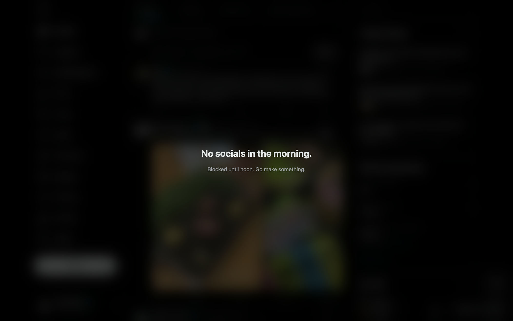

# x-brake

A Chrome extension that puts friction between you and doomscrolling. X gets a time budget, YouTube gets an AI-judged slop budget, and Shorts gets a wall. Long-form content stays free.

## How it works

**X (Twitter)**
- 10 minutes per day, shown as a small countdown pill
- Every 25 posts scrolled, a full-screen takeover asks if you're still here on purpose
- Over budget? Hold a button to buy 5 more minutes — the hold gets longer each time (3s → 10s → 30s)
- Hard block 7am–noon, grayscale 12:30am–7am

**YouTube**
- Long-form is unlimited. Music, essays, documentaries — no timer, no nudges
- Channels are judged slop or not by an LLM (once per channel, cached forever, you can override any verdict by clicking the pill)
- Slop channels share a 20 min/day budget, then the wall
- Shorts are blocked, always. No exceptions
- Click the pill to pause either budget

Everything resets at local midnight.

## Install

1. Clone this repo
2. `chrome://extensions` → Developer mode → Load unpacked → select the folder
3. Click the extension icon and paste a [Vercel AI Gateway](https://vercel.com/docs/ai-gateway) key (needed for AI slop classification; without it, only the manual channel list applies)

## Config

All knobs are constants at the top of `content.js`:

| Constant | Default | What it does |
|---|---|---|
| `DEFAULT_LIMIT_MIN` | 10 | Daily X minutes |
| `NUDGE_EVERY` | 25 | Posts between scroll takeovers |
| `SLOP_CHANNELS` | mrbeast, airrack, … | Manual slop list (checked before the AI) |
| `SLOP_LIMIT_MIN` | 60 | Weekly slop minutes |
| `HOLD_LADDER` | 3s/10s/30s | Hold time per budget extension |
| `CURFEW_START/END` | 7–12 | Hard block hours (X) |
| `GRAY_START/END` | 0.5–7 | Grayscale hours |

## Privacy

Per-site state lives in `localStorage`, the API key in `chrome.storage.local`. Nothing leaves your machine except one classification request per new channel (channel name + video title) to your own AI Gateway account. No analytics, no accounts, no sync.

## Stack

Plain JavaScript, Manifest V3, no build step, no dependencies. The AI judge is a single `chat/completions` call through a service worker, currently using `moonshotai/kimi-k3`.

